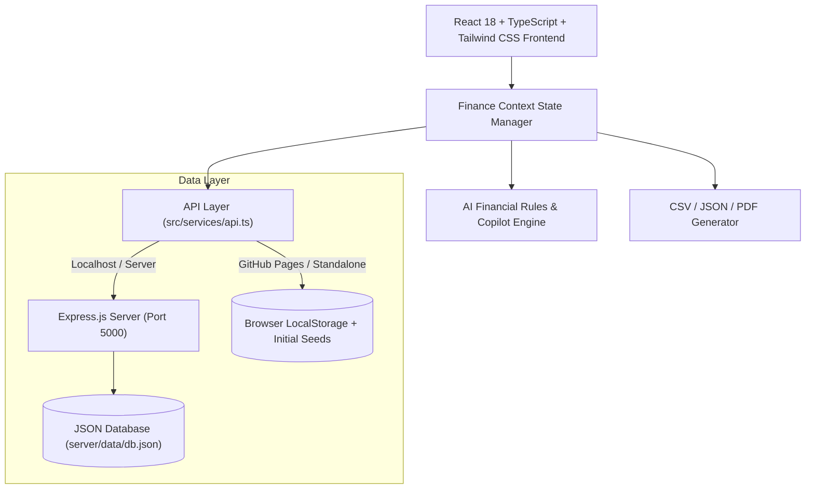

# 💎 Smart Financial Dashboard (AI-Powered)

[](https://suchithakakumani.github.io/smart-financial-dashboard/)
[](https://reactjs.org/)
[](https://www.typescriptlang.org/)
[](https://tailwindcss.com/)
[](https://expressjs.com/)
[](https://nodejs.org/)

An enterprise-grade, intelligent financial analytics platform designed to monitor cash flows, optimize personal budgets, automate recurring bill tracking, track multi-asset investments, and deliver heuristic AI financial advisory insights.

🔗 **Live Demo Link:** [https://suchithakakumani.github.io/smart-financial-dashboard/](https://suchithakakumani.github.io/smart-financial-dashboard/)

---

## 🌟 Key Features

### 📊 1. Real-Time Cash Flow & Net Worth Engine
- **Holistic Wealth Tracking:** Real-time aggregation of checking balances, savings targets, and equity holdings.
- **Interactive Trajectory Curves:** Smooth Area & Bar charts powered by Recharts comparing monthly inflows, outflows, and savings velocity over 30-day, 6-month, and 1-year horizons.
- **Categorical Donut Distribution:** Visual expense distribution breakdown with percentage allocations.

### 🤖 2. Smart AI Financial Copilot & Health Score
- **Institutional Health Score (0-100):** Evaluates financial vitality across 5 pillars: Savings Rate, Budget Adherence, Debt-to-Income, Emergency Reserves, and Subscription Burn.
- **Dynamic Anomaly Detection:** Flags category overruns (e.g., dining out pace warnings, savings milestones).
- **Interactive AI Chat:** Ask natural questions such as:
  - *"Can I afford a $500 tech purchase today?"*
  - *"What is my 50/30/20 budget breakdown?"*
  - *"Analyze my recurring subscriptions and recommend cuts."*

### 💳 3. Smart Budget Governor
- Category-level envelope budgeting (Housing, Food & Dining, Shopping, Utilities, Travel, Health, etc.).
- Visual progress bars with dynamic warning thresholds (Green < 70%, Amber 70-90%, Red > 90%).
- Inline budget limit adjustments.

### 🎯 4. Savings Milestones & Goal Tracker
- Target funding trackers (Emergency Reserve, Vacation Funds, Real Estate Down Payment, Electric Vehicles).
- Interactive fund contributions with celebratory confetti micro-interactions.
- Estimated target completion forecasting.

### 🔄 5. Recurring Subscriptions & Bill Audit
- Centralized tracking of monthly and annual SaaS and lifestyle memberships.
- Identifies inactive or flagged subscriptions to prevent recurring leaks (with annual savings estimates).
- Pause/resume toggle and renewal calendar countdowns.

### 📈 6. Multi-Asset Investment Watchlist
- Real-time stock, ETF, and cryptocurrency tracker (NVDA, AAPL, VOO, BTC, ETH, MSFT).
- Mini SVG sparkline trendlines, 24h P&L indicators, and position cost basis calculations.

### 📑 7. Transaction Audit & Export
- Comprehensive CRUD operations: Add, filter, search, categorize, and delete transactions.
- Filter by Type (Income, Expense, Transfer) and Category.
- **Export Options:** Download transactions to CSV, snapshot entire state to JSON, or generate an executive PDF/print statement.

### 🌐 8. Dual Architecture (Offline + Fullstack Live Sync)
- **Local / Self-Hosted Mode:** Connects seamlessly to the Express REST API backend (`http://localhost:5000/api`) with disk-persisted database storage.
- **Demo / Standalone Mode:** Automatically engages a resilient client-side persistence engine (LocalStorage/Mock Engine) when deployed on GitHub Pages or offline.

---

## 🛠️ Architecture & System Design



---

## 📁 Repository Structure

```
smart-financial-dashboard/
├── .github/
│   └── workflows/
│       └── deploy.yml          # Automated GitHub Pages CI/CD workflow
├── public/
│   └── favicon.svg             # Modern fintech logo
├── src/
│   ├── components/
│   │   ├── AIAdvisorModal.tsx       # AI Financial Copilot chat interface
│   │   ├── AIInsightsBanner.tsx     # Smart alerts & anomaly detection cards
│   │   ├── BudgetManager.tsx        # Envelope budget progress & controls
│   │   ├── CashFlowChart.tsx        # Inflow vs Outflow area/bar charts
│   │   ├── ExpenseBreakdown.tsx     # Donut category distribution chart
│   │   ├── ExportReportModal.tsx    # CSV, JSON, and PDF report generator
│   │   ├── InvestmentWatchlist.tsx  # Equities & crypto holdings watchlist
│   │   ├── MetricCard.tsx           # Stat cards with trend indicators
│   │   ├── Navbar.tsx               # Header with currency, theme & profile
│   │   ├── RecentTransactions.tsx   # Filterable transaction table with search
│   │   ├── SavingsGoals.tsx         # Savings targets with confetti feedback
│   │   ├── Sidebar.tsx              # Modern collapsible sidebar navigation
│   │   ├── SubscriptionsManager.tsx # Recurring bills & cancellation auditor
│   │   └── TransactionModal.tsx     # Add new transaction form modal
│   ├── context/
│   │   └── FinanceContext.tsx       # Global state & persistence provider
│   ├── services/
│   │   ├── aiService.ts             # Financial Health scoring & AI heuristics
│   │   ├── api.ts                   # Unified API layer with dual-mode fallback
│   │   └── initialData.ts           # Comprehensive realistic starter data
│   ├── types/
│   │   └── index.ts                 # TypeScript data contracts & types
│   ├── utils/
│   │   ├── exportUtils.ts           # CSV and print utilities
│   │   └── formatters.ts            # Currency and relative date formatters
│   ├── App.tsx                      # Primary layout & tab coordinator
│   ├── index.css                    # Tailwind CSS directives & custom scrollbars
│   └── main.tsx                     # React DOM root entry
├── server/
│   ├── data/
│   │   ├── database.js              # Persistent file-based store
│   │   └── seedData.json            # Initial database seeds
│   └── server.js                    # Express.js REST API server
├── package.json
├── tailwind.config.js
├── tsconfig.json
└── vite.config.ts
```

---

## 🚀 Getting Started

### Prerequisites
- [Node.js](https://nodejs.org/) (v18.0.0 or higher recommended)
- [npm](https://www.npmjs.com/) (v9.0.0 or higher)

### 1. Clone the repository
```bash
git clone https://github.com/SuchithaKakumani/smart-financial-dashboard.git
cd smart-financial-dashboard
```

### 2. Install dependencies
```bash
npm install
```

### 3. Run the development environment
To launch both the Express backend (`http://localhost:5000`) and the Vite React frontend (`http://localhost:3000`) concurrently:
```bash
npm run dev
```

Or run them individually:
```bash
# Frontend only
npm run dev:client

# Backend only
npm run dev:server
```

### 4. Build for Production
```bash
npm run build
```
Compiled production assets will be generated in `./dist`.

---

## 📡 REST API Documentation

| Endpoint | Method | Description |
| :--- | :--- | :--- |
| `/api/health` | `GET` | Server health check and uptime status |
| `/api/summary` | `GET` | Aggregated inflow, outflow, net savings, and savings velocity |
| `/api/transactions` | `GET` | List transactions with optional query filters (`category`, `type`, `search`) |
| `/api/transactions` | `POST` | Record a new financial transaction |
| `/api/transactions/:id` | `PUT` | Update existing transaction details |
| `/api/transactions/:id` | `DELETE` | Delete a transaction record |
| `/api/budgets` | `GET` | Retrieve all budget category allocations |
| `/api/budgets/:id` | `PUT` | Modify budget category allocation limit |
| `/api/goals` | `GET` | Retrieve savings milestones and current accumulated balances |
| `/api/goals/:id` | `PUT` | Update a savings goal or contribute funds |
| `/api/subscriptions` | `GET` | Fetch recurring subscriptions and billing dates |
| `/api/subscriptions/:id` | `PUT` | Update subscription status (`active`, `paused`, `to_review`) |
| `/api/ai/advisor` | `POST` | Query heuristic AI financial advisor |

---

## 🎨 Design System & Accessibility
- **Modern Color Palette:** Emerald brand gradients with high-contrast slate text and dark mode backgrounds.
- **Glassmorphism & Micro-Interactions:** Subtle backdrop blurs, reactive badges, and confetti triggers.
- **Multi-Currency Support:** Instant conversion between `USD ($)`, `EUR (€)`, `GBP (£)`, `INR (₹)`, `JPY (¥)`, and `CAD (CA$)`.
- **Responsive Layout:** Optimized for mobile phones, tablets, laptops, and ultra-wide desktop monitors.

---

## 👤 Author

**Suchitha Kakumani**  
- GitHub: [@SuchithaKakumani](https://github.com/SuchithaKakumani)  
- Repository: [smart-financial-dashboard](https://github.com/SuchithaKakumani/smart-financial-dashboard)

---

## 📄 License

This project is licensed under the [MIT License](LICENSE).
